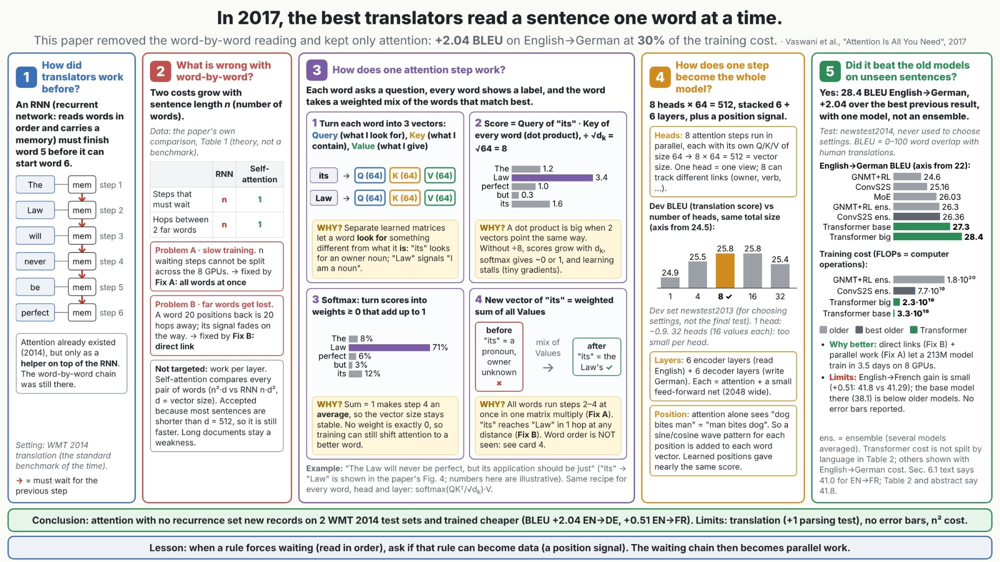

# content-explainer-slide

Turns a technical input (an experiment and its results, a paper, a pipeline, an algorithm, or a benchmark) into one 16:9 story slide of 3–6 numbered cards: what was noticed, what was wrong, how the method works, where the numbers come from, and what it achieved and taught. The bar is that a junior engineer understands it at first read: every term is defined, every number is traceable to its source, each method step shows a visible "WHY?", and the result reports gains and limits honestly. For engineers and researchers who want one image that explains a result, for a talk, a report, or a LinkedIn post.

## When to use it
- You have a paper, experiment, or benchmark and want one slide that tells its story, not a deck.
- You want every number on the slide to be traceable (from your data files, or from the paper's pages and tables).
- You want to review or fix an existing explainer slide against a clarity checklist.

## Example request
> Make one slide that explains the paper "Attention Is All You Need" (Vaswani et al., 2017) as a story.

## Example output



How the slide follows the skill's recipe:
- **Headline:** a surprising fact plus the action taken ("In 2017, the best translators read a sentence one word at a time", then what the paper changed and what it gained).
- **5 numbered cards, each titled with the question it answers:** how translators worked before → what was wrong (Problem A and Problem B, plus what was deliberately not targeted) → how one attention step works → how one step becomes the whole model → whether it beat the old models on unseen sentences.
- **Method card as WHAT / picture / WHY cells:** four steps (Query/Key/Value vectors, scores, softmax, weighted sum), each with a "WHY?" box and a before → after panel.
- **Traceable numbers:** each figure names its source (Table 1, Table 2, Fig. 4, Sec. 6.1), and the test set (newstest2014) is marked as never used to choose settings.
- **Honest result:** gains with their limits (small English→French gain, no error bars, n² cost), then a conclusion banner and a lesson banner.

## Install
```bash
cp -r content-explainer-slide ~/.claude/skills/
```
Full instructions for the agent: [SKILL.md](SKILL.md)
