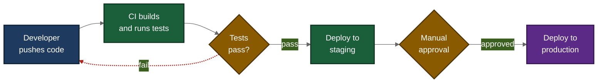

# content-mermaid

Creates and styles Mermaid diagrams (flowcharts, sequence, state, ER, class, Gantt, mindmap, timeline) for technical processes and architectures. It picks the diagram type that fits the content, applies a consistent high-contrast color system, and outputs source that renders natively on GitHub, GitLab, Notion, Obsidian and docs sites. Built for developers and technical writers who want readable diagrams without hand-tuning layout.

## When to use it

- You need a flowchart, sequence diagram, state machine or ER diagram for a README or docs page.
- You want an existing Mermaid diagram restyled, recolored or made more readable.
- You are visualizing a software process such as a CI/CD pipeline, git workflow or API flow.

## Example request

> "Make a Mermaid diagram of a typical CI/CD pipeline: a developer pushes code, CI builds and runs tests, failed tests go back to the developer, passing builds deploy to staging, a manual approval gate, then production deploy."

## Example output



- **Diagram type:** a `flowchart LR` fits a sequential pipeline with a branch and a loop; left-to-right reads like a pipeline.
- **Colors:** blue is the input (developer), green is active work (build, tests, staging deploy), amber is decisions and gates, purple is the final output (production). Every class sets both fill and text color for contrast.
- **Dashed red arrow:** the failed-tests path is a feedback loop, not the normal flow, so it is dashed and red while the main path stays solid.

_Last run: 2026-10-12 · Claude Sonnet 5.5_

## Install

```bash
cp -r content-mermaid ~/.claude/skills/
```

Full instructions for the agent: [SKILL.md](SKILL.md)
